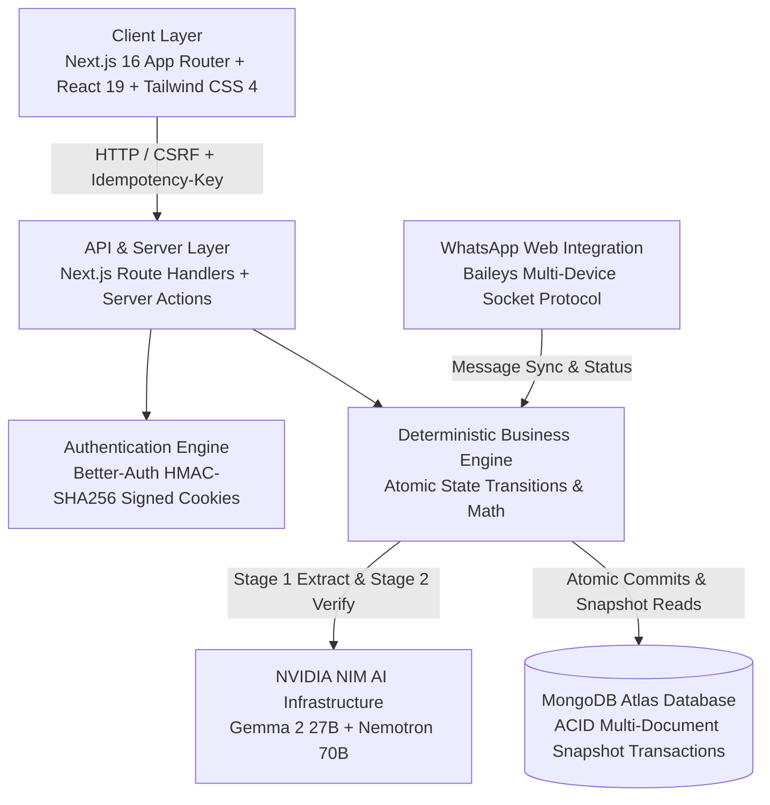
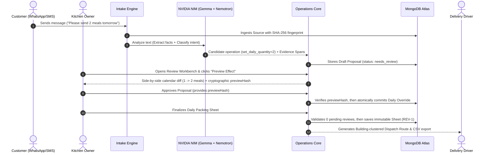
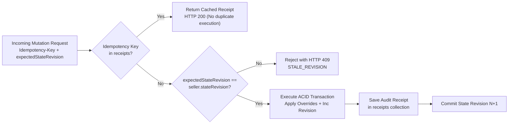
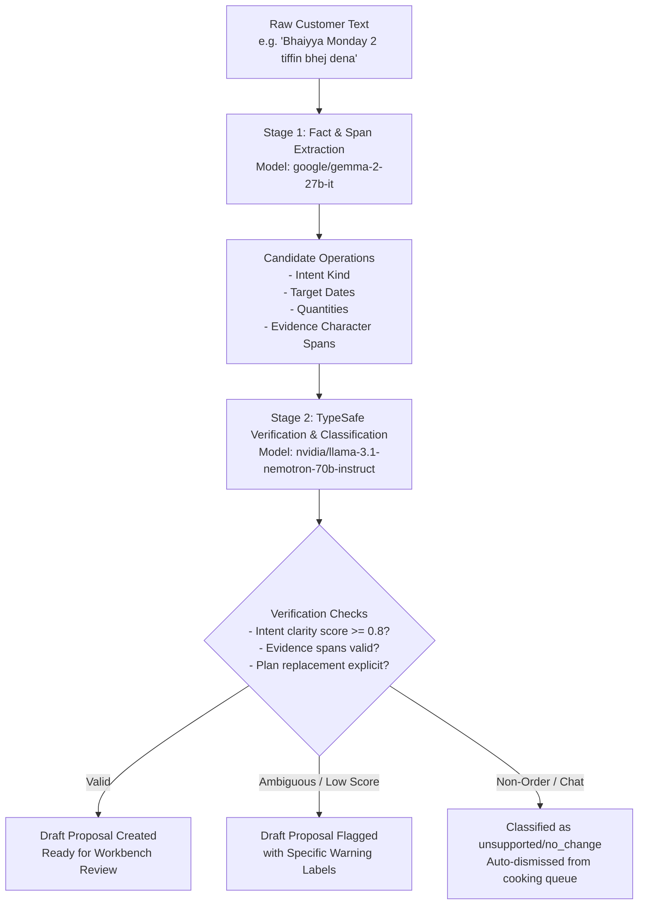
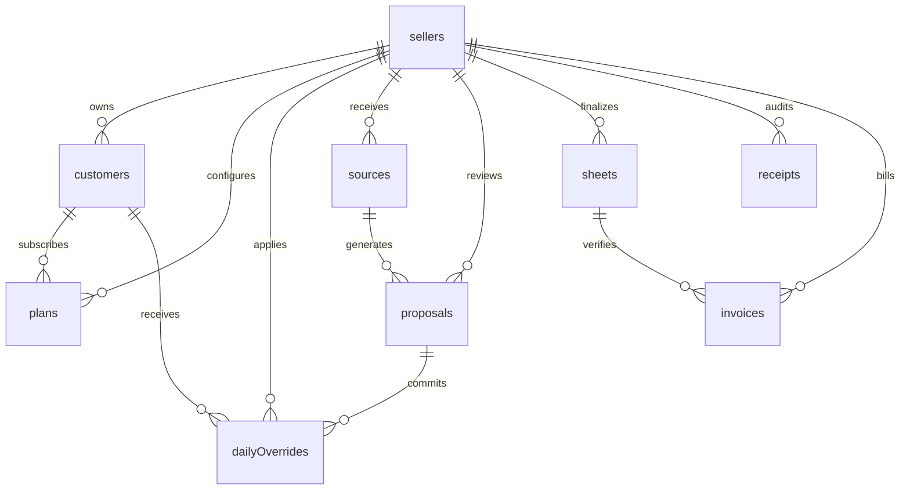

#  Demeter— Intelligent Meal & Tiffin Kitchen Management Platform
 *Named after Demeter, the Greek goddess of grain and harvest, who made sure no one went hungry.*
> **Demeter** is a production-grade, full-stack kitchen management platform purpose-built for independent home-food and tiffin businesses. Built with **Next.js 16 (App Router)**, **React 19**, **MongoDB Atlas (ACID Transactions)**, **Better-Auth**, and a two-stage **NVIDIA NIM AI pipeline** (Gemma 2 27B + Nemotron 70B), it bridges messy customer messages, recurring subscriptions, cryptographic approvals, immutable packing sheets, dispatch route logistics, and monthly billing.

---

## Table of Contents

- [1. The Problem & Solution](#1-the-problem--solution)
- [2. System Architecture](#2-system-architecture)
- [3. Core Workflows](#3-core-workflows)
  - [3.1 Message-to-Packing Sheet Pipeline](#31-message-to-packing-sheet-pipeline)
  - [3.2 State Revision & Optimistic Concurrency](#32-state-revision--optimistic-concurrency)
  - [3.3 NVIDIA NIM Two-Stage AI Pipeline](#33-nvidia-nim-two-stage-ai-pipeline)
- [4. Key Features](#4-key-features)
- [5. Technology Stack](#5-technology-stack)
- [6. Database Architecture & Collections](#6-database-architecture--collections)
- [7. How to Run Locally](#7-how-to-run-locally)
  - [Prerequisites](#prerequisites)
  - [Step 1: Clone & Navigate](#step-1-clone--navigate)
  - [Step 2: Install Dependencies](#step-2-install-dependencies)
  - [Step 3: Environment Setup](#step-3-environment-setup)
  - [Step 4: Initialize Database & Indexes](#step-4-initialize-database--indexes)
  - [Step 5: Provision Kitchen Owner & Seed Demo Data](#step-5-provision-kitchen-owner--seed-demo-data)
  - [Step 6: Generate Authenticated Session](#step-6-generate-authenticated-session)
  - [Step 7: Start Development Server](#step-7-start-development-server)
- [8. Testing & Verification](#8-testing--verification)
- [9. REST API Reference Overview](#9-rest-api-reference-overview)
- [10. Security, Privacy & Invariants](#10-security-privacy--invariants)

---

## 1. The Problem & Solution

### The Real-World Problem
Independent home tiffin kitchens serve between 15 to 100 regular subscribers who receive hot meals daily. These kitchens face daily operational friction:
* **Unstructured Customer Messages**: Cancellations, quantity increases, and pauses arrive via WhatsApp, SMS, and calls in colloquial language (*"Bhaiyya don't send food today"*, *"send 2 lunches tomorrow"*, *"out of station till Monday"*).
* **Notebooks & Memory Overload**: Owners track orders using paper diaries or messy spreadsheets.
* **Costly Errors**: A missed cancellation results in cooked food waste; a missed addition leaves a hungry customer.
* **End-of-Month Billing Nightmare**: Manually counting meals by scrolling through weeks of WhatsApp chat histories causes billing delays and payment disputes.

### The Demeter Solution
Demeter implements a strict **Propose-and-Review** paradigm:
1. **Models Propose**: NVIDIA NIM models parse incoming messages, extract structured order operations, and highlight exact evidence spans.
2. **Humans Approve**: The kitchen owner reviews a side-by-side before-and-after calendar preview and approves with a single click. Every approval is cryptographically verified against state drift (`previewHash`).
3. **Deterministic Math Calculates**: Meal quantities, customer allocations, delivery rosters, and monthly invoices are computed with deterministic TypeScript functions — never guessed by LLMs.
4. **Baseline Invariance**: Temporary changes create date-specific overrides; they never destroy the customer's permanent recurring schedule.

---

## 2. System Architecture



---

## 3. Core Workflows

### 3.1 Message-to-Packing Sheet Pipeline

The lifecycle of an order change from raw message to kitchen delivery:


---

### 3.2 State Revision & Optimistic Concurrency

To ensure zero race conditions and perfect idempotency in multi-tab or concurrent operations:



---

### 3.3 NVIDIA NIM Two-Stage AI Pipeline

Demeter decouples extraction from verification into two distinct NVIDIA NIM stages with complete audit provenance:



---

## 4. Key Features

| Feature Module | Capabilities |
|---|---|
| **Intelligent WhatsApp Intake** | Ingests informal customer messages via WhatsApp Web (Baileys) or manual paste with 24-hour duplicate suppression. |
| **NVIDIA NIM Extraction & Verification** | Two-stage pipeline extracting entities with `gemma-2-27b-it` and validating contracts with `llama-3.1-nemotron-70b-instruct`. |
| **Review & Proposal Workbench** | Side-by-side visual calendar diffs with cryptographic `previewHash` verification to guarantee what you see is what is approved. |
| **Baseline Invariance** | Weekly meal subscriptions remain untouched; one-off skips or extras are stored as atomic date-specific overrides. |
| **Immutable Packing Sheets** | Kitchen packing sheets are versioned (`REV-1`, `REV-2`). Blocks finalization if unresolved messages remain for that day. |
| **Printable Kitchen Paper** | High-contrast, ink-friendly layout engineered for kitchen clipboards and thermal receipts. |
| **Dispatch & Route Logistics** | Clusters customer deliveries by apartment building with digital checklists and driver route rosters. |
| **Monthly Invoicing & WhatsApp Share** | Automatically tallies deliveries against custom meal rates, generates itemized statements, and creates pre-filled `wa.me` billing links. |
| **Privacy, GDPR & Erasure** | One-click GDPR export (`GET /api/v1/privacy/export`), customer message text erasure, and cascading account deletion. |
| **Idempotency & Audit Trail** | Every mutating request requires an `Idempotency-Key` and records an immutable receipt in the audit ledger. |

---

## 5. Technology Stack

| Layer | Technology | Purpose |
|---|---|---|
| **Frontend Framework** | **Next.js 16.3.8 (App Router)** | Turbo-bundled Server Components, Server Actions, Dynamic Streaming |
| **UI Components** | **React 19.2.8 + Tailwind CSS 4** | Radix / Shadcn UI primitives, Base UI, Lucide Icons, Sonner |
| **Database** | **MongoDB 7.7.0 (Atlas)** | Multi-document snapshot transactions, unique & TTL indexes |
| **Authentication** | **Better-Auth 1.7.7** | HMAC-SHA256 signed session cookies, CSRF protection |
| **AI Inference** | **NVIDIA NIM Cloud API** | Gemma 2 27B (Extraction) + Nemotron 70B (JEV Verification) |
| **Messaging** | **@whiskeysockets/baileys** | Lightweight WebSocket protocol for WhatsApp multi-device sync |
| **Validation** | **Zod 4.6.5** | Strict runtime schema enforcement on every input, output, and doc |
| **Time & Dates** | **@js-temporal/polyfill** | Timezone-aware local calendar math (`Asia/Kolkata`) |

---

## 6. Database Architecture & Collections

Demeter uses 12 core collections with strict index constraints in MongoDB:



* **`sellers`**: Kitchen workspace record with business settings (timezone, active weekdays, meal quantity cap).
* **`customers`**: Customer profiles (alias, phone, delivery building/flat, packing notes).
* **`plans`**: Baseline weekly recurring schedules (Mon–Sun array of quantities).
* **`dailyOverrides`**: Date-specific quantity changes or pauses (`serviceDate`, `quantity`, `approvalId`).
* **`sources`**: Ingested customer messages with SHA-256 fingerprint and channel metadata.
* **`proposals`**: AI or manually generated change proposals with evidence character spans and draft revisions.
* **`sheets`**: Immutable finalized daily packing sheets with revision numbers (`revision: 1`).
* **`receipts`**: Audit ledger recording idempotency keys, actor user ID, prior/post state revisions, and changes.
* **`invoices`**: Monthly billing records itemizing delivered meals, credits, adjustments, and payment status.
* **`aiRuns`**: NVIDIA NIM execution audit records with token metrics, model provenance, and latency tracking.
* **`classifications`**: Intent classification records generated during NIM verification.
* **`rateLimits`**: High-performance sliding-window request throttling with automatic TTL expiration.

---

## 7. How to Run Locally

### Prerequisites
* **Node.js**: `v20.0.0` or higher (tested with `v24.x`)
* **Package Manager**: `pnpm` (enabled via Corepack)
* **MongoDB**: MongoDB Atlas cluster or local replica set supporting snapshot transactions.
* **NVIDIA NIM API Key**: Free API key from [build.nvidia.com](https://build.nvidia.com) (or `integrate.api.nvidia.com`).

---

### Step 1: Clone & Navigate
```bash
git clone https://github.com/your-username/tiffining.git
cd tiffining/Tiffining
```

---

### Step 2: Install Dependencies
Enable `pnpm` and install the project dependencies:
```bash
corepack enable
pnpm install
```

---

### Step 3: Environment Setup
Create a `.env` file in the `Tiffining` directory (refer to `.env.example`):
```env
# Core MongoDB & Auth Configuration
MONGODB_URI="mongodb+srv://<username>:<password>@cluster.mongodb.net/?retryWrites=true&w=majority"
MONGODB_DB="demo_tiffining"
BETTER_AUTH_SECRET="your-at-least-32-character-random-secret"
BETTER_AUTH_URL="http://localhost:3000"
APP_ORIGIN="http://localhost:3000"
APP_ENV="development"

# NVIDIA NIM AI Configuration
NVIDIA_API_KEY="nvapi-YOUR_NVIDIA_NIM_KEY"
NVIDIA_BASE_URL="https://integrate.api.nvidia.com/v1"
NVIDIA_PROVIDER="nvidia"
NVIDIA_EXTRACTION_MODEL="nvidia/nemotron-3.5-bolt-e4b"
NVIDIA_VERIFICATION_MODEL="nvidia/nemotron-3.5-bolt-e4b"
AI_DAILY_REQUEST_LIMIT=100
AI_DAILY_INPUT_TOKEN_LIMIT=1000000
AI_MAX_INPUT_TOKENS=16000
AI_TOTAL_TIMEOUT_MS=45000
AI_STAGE_TIMEOUT_MS=20000
```

> [!NOTE]
> Database operations like `seed:demo` and `test:backend --write-demo` require `APP_ENV=development` and a database name beginning with `demo_` to guarantee test isolation.

---

### Step 4: Initialize Database & Indexes
Verify database connectivity, create unique compound indexes, and confirm snapshot transaction capability:
```bash
pnpm db:init
```
*Expected Output:*
```text
Database indexes and snapshot transaction verified. No business records were changed.
```

---

### Step 5: Provision Kitchen Owner & Seed Demo Data
Bind a verified demo kitchen owner and populate isolated demo customers with recurring schedules:
```bash
# 1. Provision default owner
pnpm owner:provision --user-id demo-owner --confirm

# 2. Seed baseline customers ("Fictional A", "Fictional B", "Fictional C")
pnpm seed:demo --confirm
```
*Expected Output:*
```text
Owner provisioned. Seller: 9f310212-...
Synthetic demo created: service date 2026-10-26, confirmed meals 6. No AI was called.
```

---

### Step 6: Generate Authenticated Session
Generate an HMAC-signed session cookie for CLI testing and browser access:
```bash
pnpm session:generate
```
This writes the session cookie string to `.demo-cookie` and outputs the token.

---

### Step 7: Start Development Server
Launch the Next.js development server:
```bash
pnpm dev
```
The server will be ready at: **`http://localhost:3000`**

To sign in quickly in your browser:
* In development mode, click **"Development Auto-Login"** on the sign-in page (`/signin`), or:
* Open Developer Tools → **Application** → **Cookies** → Add cookie:
  * **Name**: `better-auth.session_token`
  * **Value**: The value from `.demo-cookie` (e.g. `a7rNxeb...`)
  * **Path**: `/`
* Navigate to **`http://localhost:3000/dashboard`** to access the live workbench!

---

## 8. Testing & Verification

Demeter includes a comprehensive automated verification suite:

### 1. Automated Backend End-to-End Pipeline
Runs full pipeline validation (customer creation → source ingestion → proposal generation → preview hash calculation → atomic approval → idempotency duplicate test → packing sheet finalization):
```bash
pnpm test:backend --cookie-file .demo-cookie --write-demo
```
*Expected Output:*
```text
Liveness passed; readiness HTTP 200.
Authenticated owner read passed.
API write-demo passed: source → review → approval → same-key retry → exact day → immutable sheet. Fictional records were retained.
```

### 2. Live NVIDIA NIM AI Inference Test
Validates connection, token budget limits, JSON output schemas, and provenance tracking against NVIDIA NIM:
```bash
pnpm test:ai:live --allow-provider-spend
```
*Expected Output:*
```text
Synthetic NVIDIA NIM extraction and verification contracts verified; 1 review candidates. Private provenance: .private/ai-live-<id>.json.
```

### 3. TypeScript Typecheck & Linting
```bash
# Strict Next.js + TypeScript verification
pnpm typecheck

# ESLint 9 code quality check
pnpm lint
```

### 4. Production Build Test
```bash
pnpm build
```

---

## 9. REST API Reference Overview

Demeter exposes 53 business operations with complete OpenAPI 3.1 specification at [docs/openapi.json](file:///home/love/coding/nvidia-hackthon/Amillion/Tiffining/docs/openapi.json).

### Core Endpoints

| Category | Method | Path | Description |
|---|---|---|---|
| **Health** | `GET` | `/api/health/live` | Container liveness check |
| | `GET` | `/api/health/ready` | Database & index readiness probe |
| **Seller** | `GET` | `/api/v1/me` | Current authenticated seller context & state revision |
| | `POST` | `/api/v1/settings` | Update kitchen settings (timezone, caps, cutoff times) |
| **Customers** | `GET` | `/api/v1/customers` | List active & archived customers |
| | `POST` | `/api/v1/customers` | Create a customer (requires `Idempotency-Key`) |
| | `GET` | `/api/v1/customers/{id}/schedule` | 31-day visual schedule projection |
| **Sources** | `POST` | `/api/v1/sources` | Ingest raw messages (manual or WhatsApp) |
| | `POST` | `/api/v1/sources/{id}/disposition` | Dismiss, defer, or reopen a source |
| **Proposals** | `POST` | `/api/v1/proposals/{id}/preview` | Generate cryptographic `previewHash` |
| | `POST` | `/api/v1/proposals/{id}/approve` | Atomically approve proposal with `previewHash` |
| **Sheets** | `GET` | `/api/v1/days/{serviceDate}` | Aggregated customer quantities and pending count |
| | `POST` | `/api/v1/days/{serviceDate}/sheets` | Finalize immutable packing sheet revision |
| | `GET` | `/api/v1/sheets/{id}/export?format=csv`| Download RFC 4180 kitchen CSV |
| **Dispatch** | `GET` | `/api/v1/days/{serviceDate}/dispatch` | Building-clustered delivery handover sheet |
| **Commerce** | `POST` | `/api/v1/invoices/preview` | Generate monthly statement preview |
| | `POST` | `/api/v1/invoices` | Issue finalized invoice with sequential ID |
| **Privacy** | `GET` | `/api/v1/privacy/export` | Complete GDPR personal data archive export |
| | `POST` | `/api/v1/privacy/source-erasures` | Purge raw customer message text |
| | `POST` | `/api/v1/privacy/seller-erasure` | Cascade complete account & data deletion |

---

## 10. Security, Privacy & Invariants

* **Fail-Closed Anonymous Protection**: Any request to `/api/v1/*` lacking a verified session cookie is immediately rejected with `HTTP 401 UNAUTHENTICATED`.
* **Origin & CSRF Guard**: All mutating POST requests enforce strict `Origin` header matching against `APP_ORIGIN`.
* **Idempotency Guarantee**: Mutating endpoints enforce `Idempotency-Key` headers. Duplicate requests return cached receipts without re-executing transactions.
* **Optimistic Concurrency**: Stale `expectedStateRevision` values trigger `HTTP 409 STALE_REVISION`, preventing concurrent overwrites.
* **Zero AI Production Writes**: LLMs only generate draft suggestions in the `proposals` collection. Only human approval commits data to operational collections.
* **GDPR Compliance**: Built-in support for right-to-portability and right-to-be-forgotten through audited erasure operations.

---

## License

This project was developed for the **Nebius x NVIDIA Global AI Hackathon**. Licensed under the [MIT License](LICENSE).
