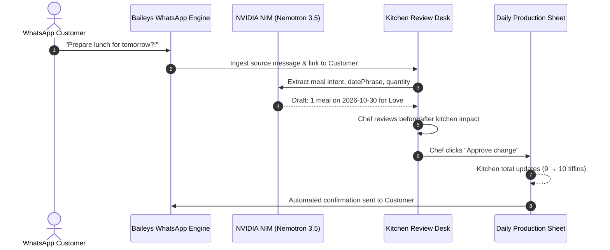

# Demeter (Tiffining) · Full Product & Video Presentation Guide

> **"More cooking. Less chasing."**  
> Demeter turns chaotic customer WhatsApp messages into reviewed packing plans, dated monthly statements, and building-by-building delivery handovers for independent tiffin kitchens.

---

## 1. What is Demeter? (The Core Problem & Solution)

### The Real-World Problem:
Independent tiffin providers (dabba-wallas, cloud kitchens, home cooks) operate on trust and high-volume daily WhatsApp chats:
- Customers message haphazardly in Hindi, Hinglish, or English:
  - *"Kal lunch me 2 tiffin bhej dena"*
  - *"Monday to Wednesday pause rakhna, Thursday resume"*
  - *"Aaj thoda kam spicy rakhna"*
- Kitchen operators maintain manual paper diaries, forget changes, cook too much or too little food, and face billing disputes at month-end when customers claim they paused meals.

### How Demeter Solves This:
1. **Live WhatsApp Integration (Baileys Web Socket):** Receives customer messages straight into the kitchen dashboard.
2. **NVIDIA NIM AI Reasoning:** Parses natural language, dates (*"kal"*, *"tomorrow"*, *"next Monday"*), and quantities into structured meal drafts.
3. **Human-in-the-Loop Review Desk:** The chef or manager has 100% control. Nothing touches the cooking sheet until the chef reviews the before/after impact and clicks **Approve**.
4. **Daily Production & Dispatch Sheet:** Real-time tally of total tiffins to cook, packing notes (e.g., Jain / less spicy), and delivery packaging list organized by tower/building.
5. **Automated WhatsApp Confirmations:** Sends an instant reply back to the customer when their change is approved.
6. **Dated Billing Statements:** Generates dispute-free monthly statements with exact meal counts and dates.

---

## 2. Core Dashboard Features & Tabs

Demeter is organized into 5 primary operational sections:

```
[Overview] ─── Daily cooking tally, customer packing notes, sheet finalization
[Review]   ─── Incoming WhatsApp stream + AI Change Tickets (Review & Approve)
[Customers]─── Customer profiles, dietary notes, weekly recurring meal plans
[Dispatch] ─── Tower-by-tower delivery handovers for delivery partners
[Billing]  ─── Monthly customer statements & dated meal audit receipts
```

---

### Tab 1: Overview (The Kitchen Desk)
* **What it does:** This is the kitchen's live whiteboard for today's service (or any selected date).
* **What you see:**
  - **Live Tiffin Count:** Total meals required for lunch today (e.g., *10 tiffins*).
  - **Capacity Gauge:** Visual bar comparing planned meals against your kitchen cap (e.g., *10 / 100 meals*).
  - **Customer Run List:** Each customer who gets food today, how many meals, and their packing instructions (e.g., *"Jain - no onion/garlic, 2nd floor flat 302"*).
  - **Sheet Finalization Button ("Lock daily plan"):** Locks the plan for the day so cooks have a finalized, immutable cooking target.

---

### Tab 2: Review (Fresh off the Phone & Change Tickets)
* **What it does:** Two-column triage desk for all incoming customer messages.
* **Column 1 — Fresh off the phone (Incoming Requests):**
  - Shows every incoming WhatsApp message or pasted message with customer identity and timestamp.
  - Buttons:
    - **Read request:** View the verbatim customer message and history.
    - **Draft with AI:** Runs NVIDIA NIM to extract dates, quantities, and intent.
* **Column 2 — Change tickets (Your call, chef):**
  - Shows AI-generated order proposals awaiting human decision.
  - Click **Review ticket** to open the **Proposal Workspace Modal**:
    - **Customer Message:** Original quote with green badge *"Verified directly from customer WhatsApp message"*.
    - **Proposed Order Update:** Customer name, delivery date, meal count.
    - **Live Kitchen Impact:** Real-time diff: e.g., `Love: 0 → 1 meal`, `Kitchen total: 9 → 10 tiffins`.
    - **Late Order Notice:** Automatically informs you if the message arrived after the 10:00 AM cutoff.
    - **Approve Change Button:** 1-click approval that writes to the database, updates the kitchen sheet, and confirms via WhatsApp.

---

### Tab 3: Customers (The People at Your Table)
* **What it does:** Directory of all kitchen regulars, their preferences, and default schedules.
* **Key Actions:**
  - **+ Add customer:**
    - Customer Name (e.g., *Rahul Sharma*, *Love*)
    - Packing Note (e.g., *Tower B Flat 401, vegetarian, less oil*)
  - **Schedule Details (Click on any customer):**
    - View their upcoming 7-day forecast.
    - **Weekly Plan:** Recurring quantities from Mon to Sun (e.g., 1 meal Mon-Fri, 0 on weekends).
    - **Overrides:** See any temporary pauses or extra meals already approved for them.
  - **Create Manual Proposal:**
    - If a customer calls or pays in cash, create a manual order ticket directly (One day override, Pause range, Resume, or New recurring plan).

---

### Tab 4: Dispatch (Delivery Handover)
* **What it does:** Organizes the day's meals for delivery boys or drivers.
* **Features:**
  - Groups tiffins by delivery route, apartment complex, or building floor.
  - Quick checklist for delivery handovers.
  - Prevents missed lunches or wrong bag deliveries.

---

### Tab 5: Billing (Statements & Invoices)
* **What it does:** Reconciles the month's delivered meals into clean statements.
* **Features:**
  - Exact count of meals actually approved and delivered (excluding pause days).
  - Total amount due based on per-meal pricing or monthly subscription.
  - Exportable CSV and WhatsApp-shareable monthly summary.

---

## 3. How to Manage Customers Step-by-Step

### Adding a New Customer:
1. Go to the **Customers** tab (`http://localhost:3000/dashboard`).
2. Click the **"+ Add customer"** button in the top right.
3. Enter:
   - **Customer Name:** e.g., `Prakhar Gupta`
   - **Packing Note:** e.g., `Tower 3, Flat 504 - Mild spice, Jain food`
4. Click **Save customer**.

### Setting Up Their Weekly Schedule:
1. In the customer row, click **Create manual proposal** (or click their name → Schedule).
2. Choose **Change type: Recurring plan**.
3. Set their weekly pattern (e.g., Monday to Friday = `1`, Saturday & Sunday = `0`).
4. Enter reason: `Standard monthly lunch subscription`.
5. Click **Create draft** → Go to **Review** tab → Click **Approve change**.

---

## 4. End-to-End Workflow: From WhatsApp to Kitchen Sheet



---

## 5. Complete Video Recording Roadmap (5-6 Minutes)

Follow this exact script when recording your demo video for submission or presentation:

### Scene 1: Introduction & Problem Statement (0:00 - 0:50)
* **Visual:** Show the Landing Page (`http://localhost:3000`) and click **Go to kitchen workspace**.
* **Narration:**
  > *"Hi everyone! This is Demeter (Tiffining). Independent tiffin kitchens and home meal services face a massive daily headache: hundreds of unstructured WhatsApp messages asking for extra meals, cancellations, and dietary changes. Diaried notes get lost, food gets wasted, and billing is a mess at month-end. Demeter is an AI-powered operating desk that turns raw messages into reviewed production sheets and dispute-free billing."*

### Scene 2: The Kitchen Overview Dashboard (0:50 - 1:40)
* **Visual:** Navigate to the **Overview** tab.
* **Narration:**
  > *"Here is the live Kitchen Desk. We can see today's service date, our daily tiffin count—currently 9 tiffins against our 100-meal cap—and our packing roster with dietary notes like Jain meals and apartment numbers. Notice that everything here is backed by an audit trail. Nothing gets cooked without an approved record."*

### Scene 3: Live Customer WhatsApp Message Intake (1:40 - 2:40)
* **Visual:** Navigate to the **Review** tab. Show the left column *"Fresh off the phone"*.
* **Narration:**
  > *"Let's look at incoming requests. Customer 'Love' sent a WhatsApp message: 'I want to order a meal for tomorrow lunch.' Demeter's live WhatsApp integration captures this in real-time. Notice the WhatsApp verification badge confirming this came directly from a linked customer number."*

### Scene 4: NVIDIA NIM AI Extraction in Action (2:40 - 3:45)
* **Visual:** Click **Review ticket** on Love's proposal.
* **Narration:**
  > *"When we inspect the ticket, our NVIDIA NIM extraction model (Nemotron 3.5 Bolt) has analyzed the natural language. It extracted the customer, recognized 'tomorrow' as Friday, October 30th, and set the quantity to 1 lunch tiffin. 
  > Demeter operates on a strict Human-in-the-Loop principle: the AI never makes changes autonomously. In the Live Kitchen Impact panel, the chef sees the exact diff: Love goes from 0 to 1 meal, and the kitchen total increases from 9 to 10 tiffins."*

### Scene 5: One-Click Approval & Kitchen Sheet Update (3:45 - 4:45)
* **Visual:** Click **Approve change**. Watch the toast confirmation and return to the **Overview** tab. Change date to tomorrow (`2026-10-30`).
* **Narration:**
  > *"With one click, we approve the change. Immediately, the proposal is closed, an automated WhatsApp confirmation reply is dispatched to Love, and our kitchen production sheet for tomorrow now reflects 10 tiffins. The cooks know exactly what to prep."*

### Scene 6: Customer Management & Monthly Billing (4:45 - 5:45)
* **Visual:** Click the **Customers** tab, open a customer's schedule, then switch to the **Billing** tab.
* **Narration:**
  > *"In the Customers tab, kitchens manage regular customers, their dietary instructions, and recurring weekly meal subscriptions. And when the month ends, the Billing tab calculates statements based strictly on meals that were approved and delivered—completely eliminating payment disputes."*

### Scene 7: Conclusion & Architecture (5:45 - 6:15)
* **Visual:** Show the clean dashboard with all tickets cleared.
* **Narration:**
  > *"Demeter bridges real-world small business communication on WhatsApp with enterprise-grade state machine guarantees, powered by NVIDIA NIM AI, MongoDB Atlas, and Next.js. Thank you!"*

---

## 6. Quick Reference: Useful Commands & URLs

| Action | URL / Command |
| :--- | :--- |
| **Kitchen Dashboard** | `http://localhost:3000/dashboard` |
| **Landing Page** | `http://localhost:3000/` |
| **Dev Auth Check** | `http://localhost:3000/api/dev/auth-check` |
| **Reprocess WhatsApp** | `http://localhost:3000/api/dev/whatsapp/reprocess` |
| **Run Backend Smoke Test** | `pnpm test:backend` |
| **Run NVIDIA AI Live Test** | `pnpm test:ai:live` |
| **GitHub Repository** | `https://github.com/loveyadav1015/demeter` |

